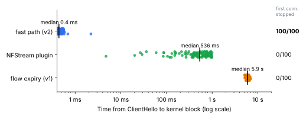
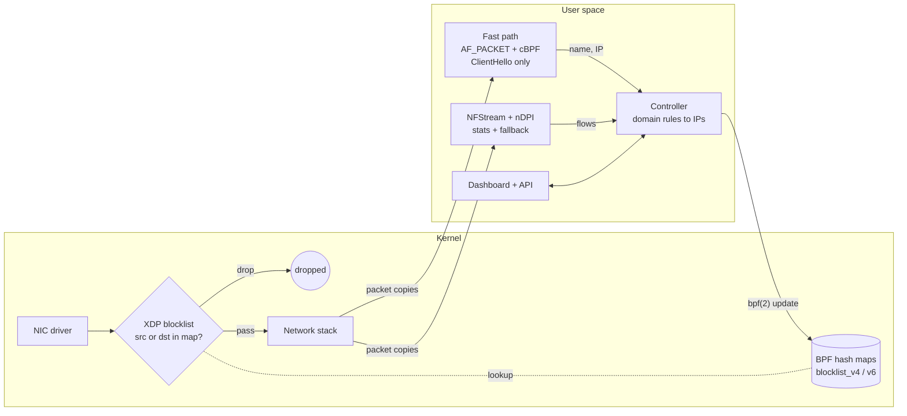

# DPI Guard: Domain Blocking at Kernel Speed with eBPF/XDP

[](https://github.com/shelenderrkumar/Network-Monitoring-App/actions/workflows/ci.yml)


DPI Guard recognises which **domain** each connection on a Linux interface goes to (TLS SNI,
QUIC, DNS, HTTP, via nDPI) and blocks the ones you choose by dropping their packets in the
kernel's **XDP hook**. It began as my final-year project at SEECS, NUST, and was rebuilt to
answer one question: *how fast can a DPI-guided blocker act, and does it stop the very first
connection?* The answer is that the delay comes from packet capture, not from DPI or the
kernel: a narrow, unbuffered tap for TLS ClientHellos blocks a domain in under a millisecond and
stops every first connection, while the usual capture paths let them all through.

## Results

100 trials per path, on a Linux 6.18 virtual machine with a veth testbed. Every number below is
computed from [`bench/results/time_to_block.csv`](bench/results/time_to_block.csv).

| How the domain is acted on | Median time from ClientHello to kernel block | First connections stopped | Never acted on |
|---|---|---|---|
| Flow export (v1 design) | 5,940 ms | 0 / 100 | 7 / 100 |
| Per-packet DPI plugin | 535.7 ms | 0 / 100 | 0 / 100 |
| **TLS ClientHello fast path (v2)** | **0.44 ms** | **100 / 100** | 0 / 100 |

- **Round-trip time** ([`rtt_sweep.csv`](bench/results/rtt_sweep.csv)): with an emulated
  100 ms round trip to the server, the plugin stops 12 of 100 first connections. The fast path
  stops 100 of 100 at every round-trip time from 5 ms to 1,000 ms.
- **Split ClientHello** ([`split_hello.csv`](bench/results/split_hello.csv)): when the server
  name falls in the second TCP segment, the fast path cannot read it. Falling back to the
  plugin blocks in a median of 465.8 ms; the old flow-export fallback took 5,847.5 ms.
- **Blocklist size** ([`drop_cost.csv`](bench/results/drop_cost.csv)): an XDP hash map and an
  nftables set forward allowed traffic at a flat rate from 1 to 10,000 blocked addresses, while
  linear iptables rules fall from 435.0 to 8.596 kpps.



**Paper:** [*Blocking the First Connection: Where the Time Goes in DPI-Guided XDP
Enforcement*](paper/main.pdf) (preprint; LaTeX source and figure scripts in [`paper/`](paper/)).

## How it works



1. **XDP program** (`dpiguard/bpf/xdp_blocklist.c`): parses Ethernet, up to two VLAN tags and
   IPv4/IPv6, and drops a packet whose source **or** destination is in a pinned hash map
   (65,536 entries per family). Each entry counts the packets and bytes it dropped.
2. **Fast path** (`dpiguard/fastpath.py`): an `AF_PACKET` socket with a classic-BPF filter that
   wakes user space only for TLS ClientHellos, then parses the SNI immediately.
3. **NFStream + nDPI**: full DPI for the dashboard's statistics, and a fallback for names the
   fast path can't see (QUIC, DNS, HTTP, split ClientHellos).
4. **Controller and policy** (`dpiguard/policy.py`): a rule like `youtube.com` covers all
   subdomains. Every observed (domain, IP) pair is remembered, so unblocking removes exactly
   the IPs no remaining rule needs, and a blocked IP that also serves an allowed domain is
   flagged as **collateral**.
5. **Map access** (`dpiguard/bpf_maps.py`): pure-Python `bpf(2)` system calls. No BCC and
   no kernel headers at run time; the XDP object is compiled once with clang.

## Quick start

Requires Linux 5.x+, root, `clang`, `libbpf-dev` and `iproute2`.

```bash
git clone https://github.com/shelenderrkumar/Network-Monitoring-App.git && cd Network-Monitoring-App
python -m venv .venv && source .venv/bin/activate
pip install -e ".[dev]"
sudo .venv/bin/dpiguard --iface eth0 --block youtube.com      # dashboard on http://127.0.0.1:5000
```

| Option | Meaning |
|---|---|
| `--mode fastpath` (default) / `early` / `expiry` | how quickly names are acted on (see results) |
| `--enforcer xdp` (default) / `nft` / `memory` | XDP, nftables baseline, or dry run |
| `--xdp-mode drv` / `generic` | native driver XDP, or generic mode for NICs without support |
| `DPIGUARD_PASSWORD=...` | require HTTP Basic auth for the dashboard and API |

API: `GET /api/state`, `POST /api/rules {"rule": "example.com"}`, `DELETE /api/rules/<rule>`.

## Reproducing the results

Needs root on Linux. These are the exact commands behind `bench/results/`:

```bash
sudo bench/testbed.sh                     # veth pair + namespace + TLS server
PY=.venv/bin/python
sudo $PY bench/time_to_block.py --trials 100 --modes expiry,early,fastpath --delays 0 --out time_to_block.csv
sudo $PY bench/time_to_block.py --trials 100 --modes early,fastpath --delays 5,10,25,50,100,250,500,1000 --out rtt_sweep.csv
sudo $PY bench/time_to_block.py --trials 100 --modes fastpath,fastpath:expiry --delays 0,50 --split 100 --out split_hello.csv
sudo $PY bench/drop_cost.py --runs 5 --seconds 5 --sizes 1,10,100,1000,10000
pip install -e ".[bench]" && $PY bench/plot.py   # README figures -> docs/figures/
$PY paper/figures.py                             # paper figures, tables and every number in the text
```

## Testing

```bash
pytest -q -m "not privileged"     # unit tests, no root needed
sudo .venv/bin/pytest -q -m privileged   # real XDP + nftables on a veth pair in a namespace
```

CI runs both: the privileged job runs the real-kernel tests on GitHub's Ubuntu runners.

## Limitations

- Blocking is IP-based: shared hosting and CDNs cause collateral blocking (reported, not
  prevented), and Encrypted Client Hello (ECH) hides the SNI.
- The fast path covers IPv4 TLS over TCP and reads only the ClientHello's first segment.
  Post-quantum key shares make multi-segment ClientHellos common; for those, enforcement falls
  back to the plugin's sub-second delay (see the split-ClientHello result above).
- Benchmarks ran in a virtual machine on veth interfaces, which hides XDP's main advantage
  on physical NICs (dropping before socket-buffer allocation).

## History

Version 1 (the final-year project) was a Flask dashboard with BCC-compiled XDP and
NFStream flow export. It is preserved in the git history (commit `e801fc4`). Version 2
rewrote it around the findings above.

## License

MIT (the eBPF program is GPL-2.0, as required for kernel helpers).
