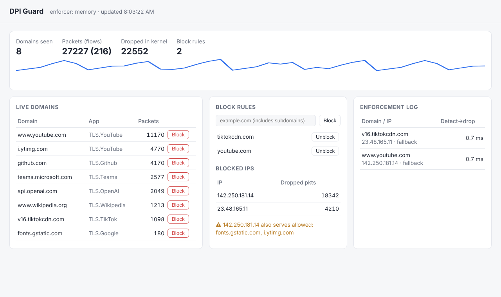
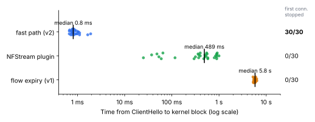
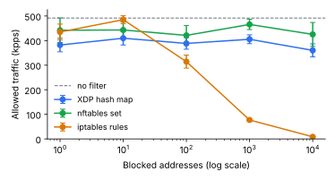
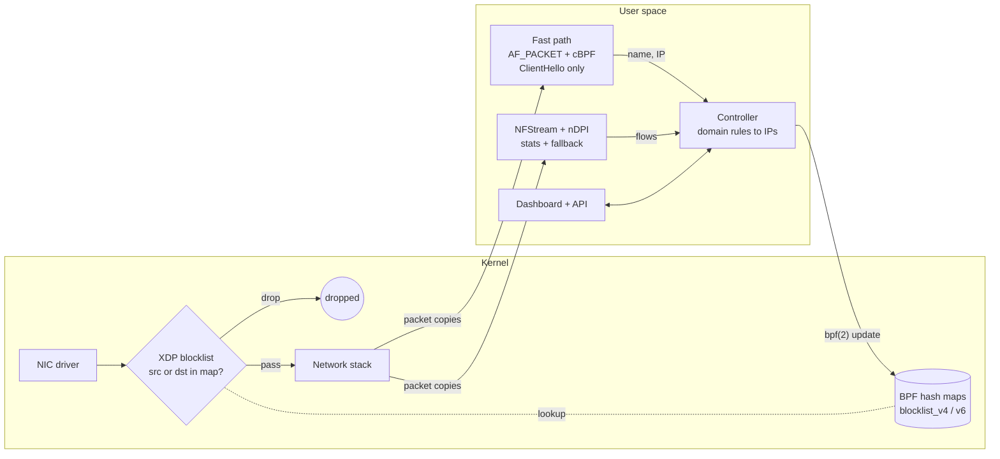

# DPI Guard: Domain Blocking at Kernel Speed with eBPF/XDP

[](https://github.com/shelenderrkumar/Network-Monitoring-App/actions/workflows/ci.yml)


DPI Guard watches the traffic on a Linux interface, recognises which **domains** each connection
goes to (TLS SNI, QUIC, DNS, HTTP, via nDPI), and blocks the ones you choose by dropping their
packets in the **kernel's XDP hook**, before the network stack even sees them.

It started as my final-year project at SEECS, NUST, and was rebuilt to answer a research
question: *how fast can a DPI-guided blocker act, and does it stop the very first connection?*

<picture>
  <source media="(prefers-color-scheme: dark)" srcset="docs/dashboard-dark.png">
  
</picture>
<sub>Dashboard with sample data: the warning shows a blocked IP that also serves allowed domains.</sub>

## Key finding

Measured on a Linux 6.18 testbed (details and raw data in `bench/`):

| How the domain is acted on | Median time from ClientHello to kernel block | First connection stopped |
|---|---|---|
| When NFStream exports the flow (v1 design) | 5,806 ms (11 of 30 never acted on) | 0 / 30 |
| NFStream per-packet plugin | 489 ms | 0 / 30 |
| **Fast path (v2)** | **0.81 ms** | **30 / 30** |

The bottleneck was never DPI or the kernel: it was **packet capture buffering**. libpcap's
buffered mode hands packets to user space in blocks on a ~1 s timer. A filtered `AF_PACKET`
socket that wakes only for TLS ClientHellos removes that delay.



The blocklist itself scales: an XDP hash map (like an nftables set) keeps a constant per-packet
cost from 1 to 10,000 blocked addresses, while linear iptables rules drop from 435 to 8.6 kpps.



## How it works



1. **XDP program** (`dpiguard/bpf/xdp_blocklist.c`): parses Ethernet, up to two VLAN tags and
   IPv4/IPv6, and drops a packet whose source **or** destination is in a pinned hash map
   (65,536 entries per family). Each entry counts the packets and bytes it dropped.
2. **Fast path** (`dpiguard/fastpath.py`): an `AF_PACKET` socket with a classic-BPF filter that
   wakes user space only for TLS ClientHellos, then parses the SNI immediately.
3. **NFStream + nDPI**: full DPI for the dashboard's statistics, and a fallback for names the
   fast path can't see (QUIC, DNS, HTTP, split ClientHellos).
4. **Controller and policy** (`dpiguard/policy.py`): a rule like `youtube.com` covers all
   subdomains. Every observed (domain, IP) pair is remembered, so unblocking removes exactly
   the IPs no remaining rule needs, and a blocked IP that also serves an allowed domain is
   flagged as **collateral**.
5. **Map access** (`dpiguard/bpf_maps.py`): pure-Python `bpf(2)` system calls. No BCC and
   no kernel headers at run time; the XDP object is compiled once with clang.

## Quick start

Requires Linux 5.x+, root, `clang`, `libbpf-dev` and `iproute2`.

```bash
git clone https://github.com/shelenderrkumar/Network-Monitoring-App.git && cd Network-Monitoring-App
python -m venv .venv && source .venv/bin/activate
pip install -e ".[dev]"
sudo .venv/bin/dpiguard --iface eth0 --block youtube.com      # dashboard on http://127.0.0.1:5000
```

| Option | Meaning |
|---|---|
| `--mode fastpath` (default) / `early` / `expiry` | how quickly names are acted on (see results) |
| `--enforcer xdp` (default) / `nft` / `memory` | XDP, nftables baseline, or dry run |
| `--xdp-mode drv` / `generic` | native driver XDP, or generic mode for NICs without support |
| `DPIGUARD_PASSWORD=...` | require HTTP Basic auth for the dashboard and API |

API: `GET /api/state`, `POST /api/rules {"rule": "example.com"}`, `DELETE /api/rules/<rule>`.

## Reproducing the evaluation

```bash
sudo bench/testbed.sh                          # veth pair + namespace + TLS server
sudo .venv/bin/python bench/time_to_block.py   # E1: time-to-block per mode
sudo .venv/bin/python bench/drop_cost.py       # E2 + E3: drop cost and blocklist scaling
pip install -e ".[bench]" && python bench/plot.py
```

Raw results are in `bench/results/`, and figures in `docs/figures/`.

## Testing

```bash
pytest -q -m "not privileged"     # unit tests, no root needed
sudo .venv/bin/pytest -q -m privileged   # real XDP + nftables on a veth pair in a namespace
```

CI runs both: the privileged job runs the real-kernel tests on GitHub's Ubuntu runners.

## Limitations

- Blocking is IP-based: shared hosting and CDNs cause collateral blocking (reported, not
  prevented), and Encrypted Client Hello (ECH) hides the SNI.
- The fast path covers IPv4 TLS over TCP with the ClientHello in one segment; everything
  else falls back to NFStream, with its capture delay.
- Benchmarks ran in a virtual machine on veth interfaces, which hides XDP's main advantage
  on physical NICs (dropping before socket-buffer allocation).

## History

Version 1 (the final-year project) was a Flask dashboard with BCC-compiled XDP and
NFStream flow export. It is preserved in the git history (commit `7b8bbdd`). Version 2
rewrote it around the findings above.

## License

MIT (the eBPF program is GPL-2.0, as required for kernel helpers).
